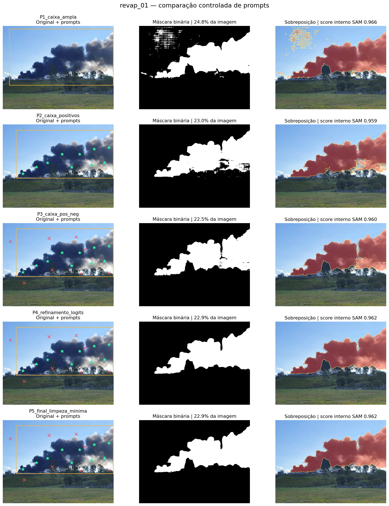
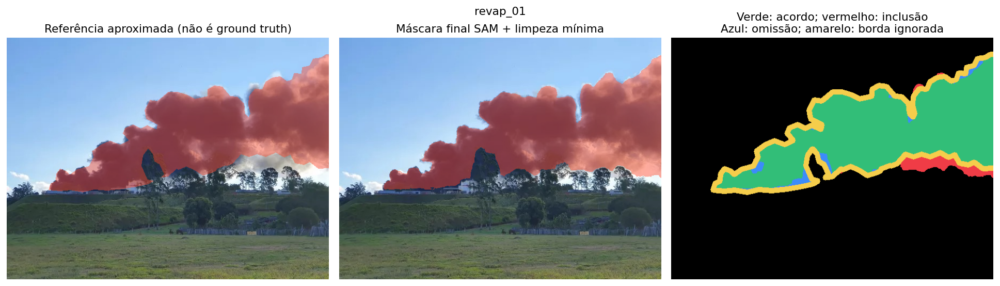
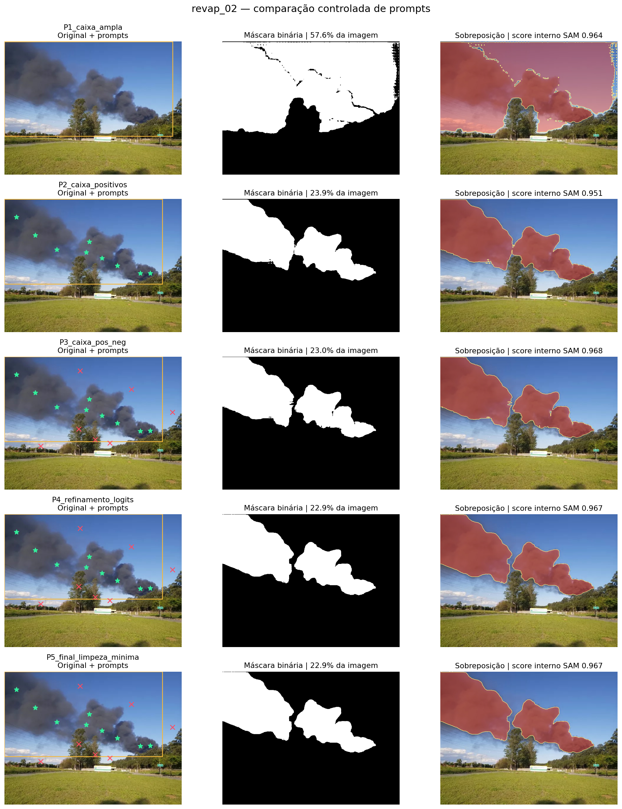
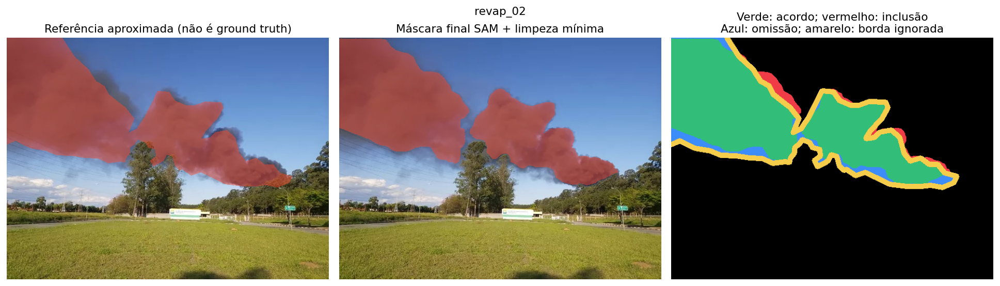
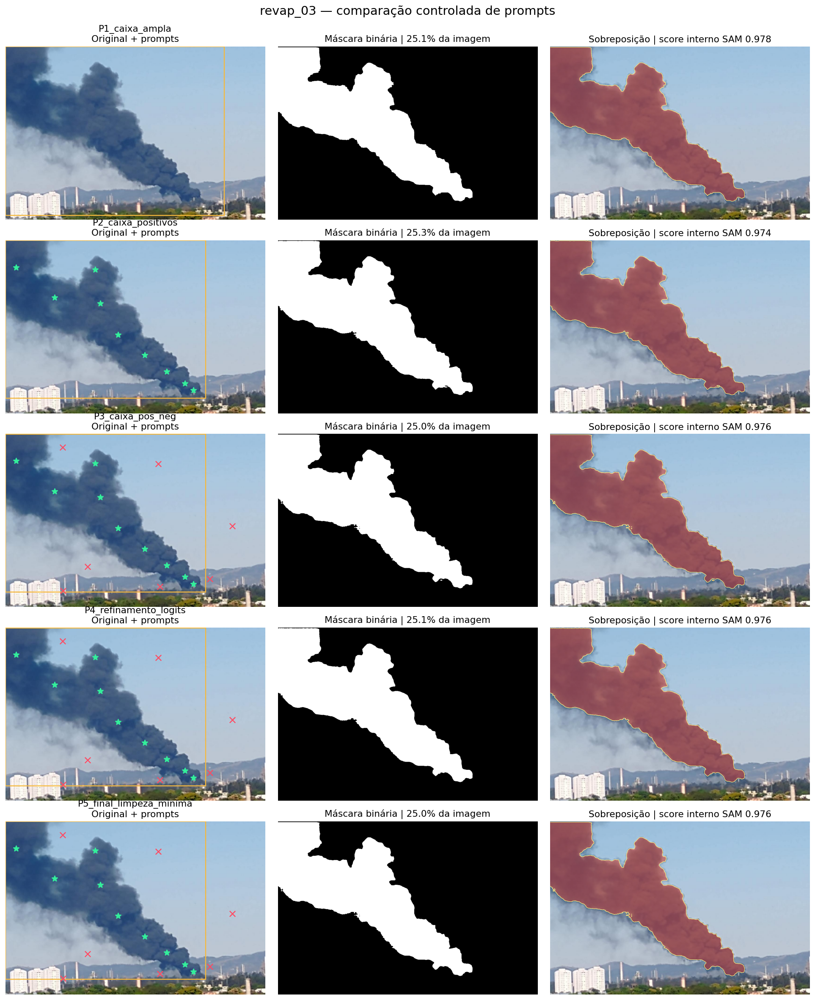
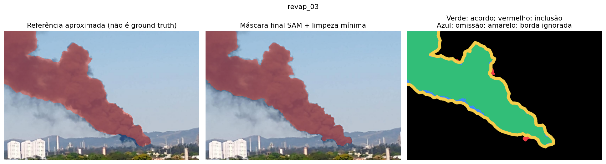

# REVAP — avaliação dos experimentos SAM

Eduardo Nascimento — RA 168800 · Rebeka Wolpi — RA 176598

## Método e limites

Utilizamos o SAM oficial ViT-B em quatro configurações por foto e uma limpeza mínima. P1 usa caixa ampla, P2 caixa ajustada e pontos positivos, P3 acrescenta negativos, P4 reutiliza logits de P3 para refinamento. Os três candidatos SAM são registrados. A seleção automática usa consistência com prompts, score interno e vazamento da caixa, sem consultar os polígonos de avaliação. A configuração final está em prompts.json.

Os polígonos de referência foram traçados por inspeção visual antes da inferência. São aproximações para discussão, sem validação independente. A faixa de 1,2% da menor dimensão ao redor das bordas é ignorada nas métricas. IoU/Dice abaixo medem acordo com essa aproximação, não acurácia validada. O score interno SAM também não é acurácia medida. Os prompts e as referências usam as mesmas três imagens de desenvolvimento; não existe conjunto de teste externo.

## revap_01

A pluma escura contrasta com o céu azul. Na direita há fumaça clara, reflexos e céu visível entre lobos; árvores ocultam a borda inferior. O contorno translúcido não tem limite único. Pontos positivos cobrem o núcleo e os lobos à direita; negativos marcam céu e vegetação. A caixa ampla permite observar vazamento na linha do horizonte.

| Configuração | IoU aprox. | Dice aprox. | Precisão aprox. | Recall aprox. | Área (px) |
|---|---:|---:|---:|---:|---:|
| P1_caixa_ampla | 0.853 | 0.921 | 0.876 | 0.971 | 66876 |
| P2_caixa_positivos | 0.904 | 0.950 | 0.944 | 0.955 | 62099 |
| P3_caixa_pos_neg | 0.914 | 0.955 | 0.951 | 0.960 | 60869 |
| P4_refinamento_logits | 0.920 | 0.959 | 0.946 | 0.972 | 61820 |
| P5_final_limpeza_minima | 0.921 | 0.959 | 0.946 | 0.972 | 61817 |

Variação do IoU aproximado P1 → final: +0.067. Final escolhida: P4_refinamento_logits; justificativa: Inspeção visual: o refinamento preserva a coluna e a fumaça clara à direita, reduz pequenos artefatos e mantém as oclusões por árvores. Persistem ambiguidades de céu entre filamentos.

A máscara final deixa 1518 pixels da referência aproximada de fora e inclui 2984 pixels fora dela, na região avaliada. Esses números dependem da anotação e não resolvem a ambiguidade da fumaça translúcida.

## revap_02

A fumaça é cinza e menos contrastada que na primeira foto. Dois agrupamentos visuais se encontram em uma transição translúcida; árvores encobrem a parte central, fios atravessam o céu e nuvens claras aparecem perto do horizonte. Negativos na vegetação ajudam a excluir a oclusão sem preencher o espaço atrás das árvores. A pluma sai pelo topo/esquerda: sua extensão total está fora do enquadramento.

| Configuração | IoU aprox. | Dice aprox. | Precisão aprox. | Recall aprox. | Área (px) |
|---|---:|---:|---:|---:|---:|
| P1_caixa_ampla | 0.392 | 0.564 | 0.395 | 0.983 | 155513 |
| P2_caixa_positivos | 0.908 | 0.952 | 0.956 | 0.947 | 64444 |
| P3_caixa_pos_neg | 0.898 | 0.946 | 0.962 | 0.931 | 62233 |
| P4_refinamento_logits | 0.893 | 0.943 | 0.961 | 0.926 | 61843 |
| P5_final_limpeza_minima | 0.893 | 0.943 | 0.961 | 0.926 | 61843 |

Variação do IoU aproximado P1 → final: +0.500. Final escolhida: P4_refinamento_logits; justificativa: Inspeção visual: o refinamento exclui o céu incluído por P1, conserva os lobos principais e respeita a oclusão das árvores. A faixa translúcida inferior continua ambígua; o score interno não é o critério único de avaliação.

A máscara final deixa 4294 pixels da referência aproximada de fora e inclui 2200 pixels fora dela, na região avaliada. Esses números dependem da anotação e não resolvem a ambiguidade da fumaça translúcida.

## revap_03

A imagem aproximada apresenta compressão e menor contraste de cor entre céu e bordas azuladas da fumaça. Há filamentos translúcidos na parte inferior e prédios/serra próximos da fonte. Pontos positivos ao longo do eixo e negativos na serra, nos prédios e no céu procuram preservar a coluna principal. A margem esquerda recorta a pluma e a perspectiva impede interpretar o ângulo da imagem como rumo geográfico.

| Configuração | IoU aprox. | Dice aprox. | Precisão aprox. | Recall aprox. | Área (px) |
|---|---:|---:|---:|---:|---:|
| P1_caixa_ampla | 0.974 | 0.987 | 0.993 | 0.982 | 206544 |
| P2_caixa_positivos | 0.973 | 0.986 | 0.991 | 0.982 | 207740 |
| P3_caixa_pos_neg | 0.970 | 0.985 | 0.993 | 0.977 | 205439 |
| P4_refinamento_logits | 0.972 | 0.986 | 0.993 | 0.979 | 205965 |
| P5_final_limpeza_minima | 0.971 | 0.985 | 0.993 | 0.977 | 205408 |

Variação do IoU aproximado P1 → final: -0.004. Final escolhida: P3_caixa_pos_neg; justificativa: Inspeção visual: P3 explicita a exclusão do céu, prédios e serra; o núcleo permanece semelhante ao de P1. A caixa sozinha já tem alto acordo aproximado e prompts adicionais não aumentam esse índice. Nenhuma versão resolve todos os filamentos translúcidos.

A máscara final deixa 4482 pixels da referência aproximada de fora e inclui 1283 pixels fora dela, na região avaliada. Esses números dependem da anotação e não resolvem a ambiguidade da fumaça translúcida.

## Discussão da imagem e dos prompts

Fumaça não é um objeto opaco com borda única. Há transições graduais, céu entre fragmentos e oclusões por árvores, prédios e fios. Pontos positivos distribuídos incluem lobos desconectados; negativos em céu/vegetação limitam inclusões. Uma caixa retangular sozinha não descreve essas formas. Pontos negativos em regiões ambíguas também podem excluir fumaça real. Não há ganho garantido ao adicionar prompts.

Iluminação de fundo e espalhamento tornam a fumaça clara semelhante às nuvens. Sombra e fumaça escura produzem contraste elevado com céu azul, mas podem se confundir com vegetação e edifícios. O contraste local exportado é diagnóstico: o anel externo pode conter outros objetos e não é uma medida física da atmosfera. Não se usa limiar de cor escura, pois ele descartaria fumaça clara. Não se preenchem todos os buracos nem se expande a máscara indiscriminadamente.

As medidas são em pixels. PCA fornece orientação de um eixo sem sentido (módulo 180°), não rumo geográfico ou direção do vento. Perspectiva e ausência de escala, posição/orientação da câmera e horário impedem conversão para metros, comparação direta com azimutes ERA5 e cálculo de correlação válida. Não se estima concentração a partir da intensidade da fotografia.

## ERA5 e equações

O arquivo foi validado (8 horários, grade 5×5, u10/v10 em m/s). A série completa é preservada. Exportam-se grade, vizinho mais próximo e interpolação bilinear. Velocidade = hypot(u,v); ângulo matemático = atan2(v,u); azimute para onde vai = atan2(u,v); direção meteorológica de onde vem = azimute + 180°. Direção é indefinida em calmaria. A primeira amostra (15h) antecede as 15h15 e serve de suporte à interpolação; não há extrapolação após as 22h.

O cenário adicional resolve advecção–difusão 2D com vento espacialmente uniforme e variável no tempo pela convolução da solução de Green gaussiana. A integral do vento linear por partes é exata; a emissão contínua usa quadratura de ponto médio com passo 60 s. K=20 m²/s e largura inicial 100 m são hipóteses ilustrativas, emissão = 1 unidade de traçador/s. Não representam parâmetros medidos do incêndio. O modelo não resolve empuxo, pluma 3D, turbulência urbana ou deposição.

Balanço de massa: erro relativo 0.009%; diferença relativa da quadratura 120 s / 60 s: 0.012%.
